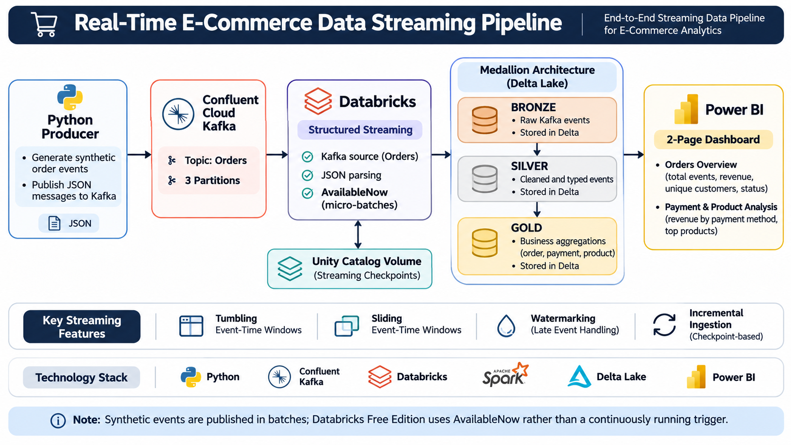
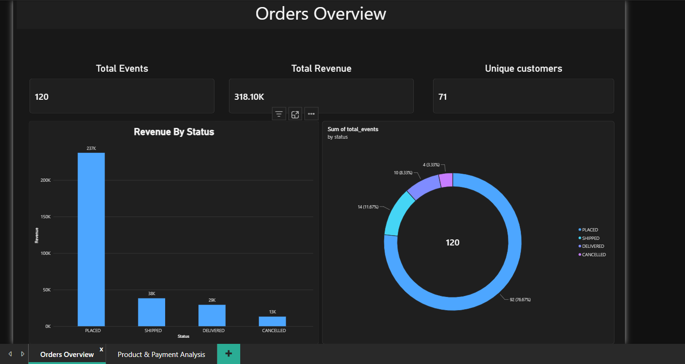
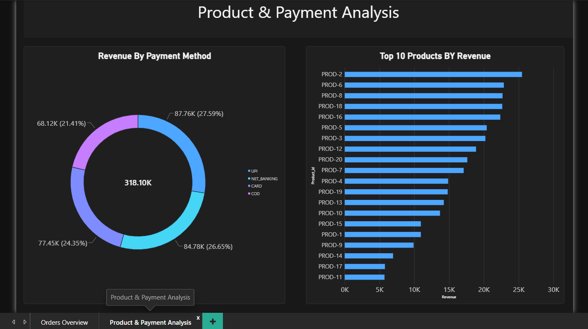

# Real-Time E-Commerce Data Streaming Pipeline

An event-driven e-commerce data engineering project built using **Python, Confluent Kafka, Apache Spark Structured Streaming, Databricks, Delta Lake and Power BI**.

The project demonstrates Kafka-based event ingestion, incremental data processing, Medallion Architecture, event-time windowing, watermarking and business analytics.

---

## Architecture

The following diagram illustrates the complete data flow, from synthetic order generation to business intelligence.



**Data Flow:**

Python Producer → Confluent Cloud Kafka → Databricks Structured Streaming → Bronze → Silver → Gold → Power BI

---

## Technology Stack

| Technology | Purpose |
|---|---|
| Python | Synthetic order event generation |
| Confluent Cloud Kafka | Event ingestion and message distribution |
| Apache Spark | Distributed data processing |
| PySpark Structured Streaming | Incremental stream processing |
| Databricks | Data processing environment |
| Delta Lake | Reliable storage and table management |
| Unity Catalog | Data organization and checkpoint storage |
| Power BI | Business intelligence and visualization |

---

## Project Implementation

### 1. Event Generation and Kafka Ingestion

Developed a Python-based Kafka producer using the `confluent-kafka` library.

- Generated synthetic e-commerce order events.
- Created unique event IDs and order IDs.
- Generated customer IDs, product IDs, quantities, order amounts and timestamps.
- Introduced multiple order statuses using weighted randomization.
- Generated different payment methods including UPI, CARD, COD and NET_BANKING.
- Published JSON events to the Kafka topic `Orders`.
- Used order IDs as Kafka message keys.
- Configured a topic with three partitions.
- Used delivery callbacks to monitor message publishing.

Kafka authentication was configured using SASL_SSL and PLAIN authentication, with credentials stored in environment variables.

### 2. Bronze Layer — Raw Event Ingestion

Consumed Kafka messages using Spark Structured Streaming.

Implementation included:

- Connecting Databricks to Confluent Kafka.
- Reading events from the `Orders` topic.
- Parsing JSON message payloads using a predefined schema.
- Retaining Kafka metadata such as topic, partition, offset and Kafka timestamp.
- Writing incoming records into Delta tables.
- Using checkpoint locations to maintain ingestion progress.

**Output Table:**

`workspace.realtime_ecommerce.bronze_orders`

### 3. Silver Layer — Data Cleaning and Transformation

Read incoming records from the Bronze Delta table using Structured Streaming.

Transformations included:

- Converting event timestamps into timestamp data types.
- Casting numerical columns into appropriate data types.
- Filtering records with missing critical fields.
- Creating a derived event date column.
- Writing cleaned records incrementally into Delta Lake.

**Output Table:**

`workspace.realtime_ecommerce.silver_orders`

### 4. Gold Layer — Business Aggregations

Created analytical datasets using PySpark DataFrame operations.

Three Gold tables were developed:

**Order Metrics — `gold_order_metrics`**

- Total events by order status.
- Total quantity.
- Total revenue.
- Average order amount.
- Unique customers.

**Payment Metrics — `gold_payment_metrics`**

- Number of orders by payment method.
- Total revenue by payment method.
- Average order amount by payment method.

**Product Metrics — `gold_product_metrics`**

- Number of orders by product.
- Total units sold.
- Total revenue by product.

All Gold tables are stored in Delta format.

### 5. Streaming Analytics

Implemented additional Structured Streaming concepts to explore event-time processing and window-based aggregations.

**Tumbling Windows**
- Aggregated order events into fixed, non-overlapping time intervals.
- Calculated order counts and revenue for each window.

**Sliding Windows**
- Implemented overlapping time windows.
- Calculated order counts and revenue across overlapping intervals.

**Watermarking**
- Applied event-time watermarks to handle late-arriving events.
- Used Append output mode for finalized window aggregations.
- Enabled state cleanup as the watermark advances.

**Checkpointing**
- Configured separate checkpoint locations for streaming queries.
- Used persistent Unity Catalog Volumes.
- Enabled incremental processing across successive executions.

---

## Power BI Dashboard

Developed a two-page dashboard using the Gold analytical tables.

### Page 1 — Orders Overview

- Total Events
- Total Revenue
- Unique Customers
- Revenue by Order Status
- Order Distribution by Status



### Page 2 — Payment & Product Analysis

- Revenue by Payment Method
- Top 10 Products by Revenue



Power BI was used to visualize the processed Gold-layer datasets and present business-level insights.

---

## Important Implementation Note — Databricks Free Edition

The project was developed using Databricks Free Edition with Serverless compute.

Due to its streaming trigger limitations, continuously running ProcessingTime triggers were not supported. Therefore, the pipeline uses the `AvailableNow` trigger.

The event source is simulated through a Python producer that publishes orders to Kafka in batches. Databricks processes the available Kafka events in micro-batches and stops after processing the available data.

This implementation demonstrates incremental stream processing using Spark Structured Streaming, rather than a continuously running production streaming deployment.

The project also uses persistent checkpoint locations to resume processing from previously committed offsets during subsequent executions.

---

## Repository Structure

```text
Realtime-Ecommerce-Streaming/
│
├── producer/
│   └── kafka_producer.py
│
├── databricks/
│   └── kafka_ingestion.ipynb
│
├── powerbi/
│   ├── Realtime_Ecommerce_Streaming.pbix
│   └── screenshots/
│       ├── order_overview.png
│       └── payment_product_analysis.png
│
├── docs/
│   ├── architecture.png
│   └── architecture.md
│
├── requirements.txt
├── .gitignore
└── README.md
```

---

## Running the Project

### Prerequisites

- Python 3.x
- Confluent Cloud Kafka cluster
- Databricks workspace with Unity Catalog and Delta Lake support
- Power BI Desktop

### 1. Install Dependencies

```bash
pip install -r requirements.txt
```

### 2. Configure Kafka Credentials

Create a `.env` file in the project root:

```env
KAFKA_BOOTSTRAP_SERVERS=your-bootstrap-server
KAFKA_API_KEY=your-api-key
KAFKA_API_SECRET=your-api-secret
KAFKA_TOPIC=Orders
```

Never commit this file or expose your credentials.

### 3. Run the Kafka Producer

```bash
python producer/kafka_producer.py
```

The producer generates synthetic order events and publishes them to the Kafka topic.

### 4. Configure Databricks

- Create a Kafka cluster and the `Orders` topic.
- Configure the Kafka credentials in a Databricks secret scope.
- Configure the project schema and checkpoint volume.
- Update the notebook connection configuration with the new Kafka cluster details.

### 5. Execute the Databricks Notebook

Open:

`databricks/kafka_ingestion.ipynb`

Execute the pipeline cells in sequence to consume, transform and store events in the Bronze, Silver and Gold layers.

### 6. Connect Power BI

Connect Power BI to the Gold analytical tables in Databricks and open the supplied `.pbix` dashboard.

**Note:** The original Confluent Cloud cluster used during development has been deleted to avoid unnecessary resource charges. A new cluster and updated credentials are required to reproduce the Kafka ingestion workflow.

---

## Security

- Kafka credentials are loaded from environment variables.
- Databricks credentials are stored using Secret Scope.
- Sensitive configuration files are excluded through `.gitignore`.
- No API keys, passwords or personal access tokens should be committed to the repository.

---

## Key Learning Outcomes

- Kafka producers, topics, partitions and message keys.
- Kafka integration with Spark Structured Streaming.
- JSON event ingestion and schema-based parsing.
- Incremental processing and checkpoint management.
- Medallion Architecture using Delta Lake.
- PySpark transformations and aggregations.
- Event-time processing and window-based analytics.
- Tumbling and sliding window aggregations.
- Watermarking and late-arriving event handling.
- Building analytical datasets for business intelligence.